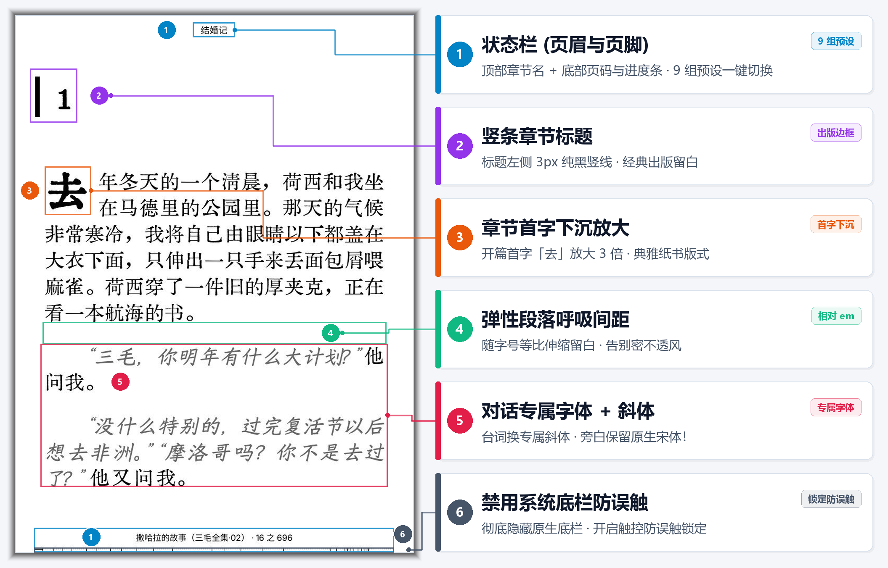

# 文笺 / Type Folio

[中文说明](#中文说明) · [English](#English)

## 中文说明

「文笺」为 EPUB 等 CRE 排版书提供开箱即用的全局平台排版预设（微信读书 / Kindle 原生 / KOBO 原生）、对话换字体与高亮、章节与正文微调（段落间距、章节标题线条、信笺下划线、引用块、首字下沉）以及高度可定制的顶部页眉与底部页脚状态栏。
与「阅笺 / Reading Folio」为同族插件。

### 排版效果全景展示

下图为使用「文笺」排版《撒哈拉的故事》第一章「结婚记」的真实阅读效果，集成了 **KOBO 原生风格**、**首字下沉**、**对话独立字体与斜体** 以及 **自研防误触状态栏** 等核心能力：

  
  
<em>(点击图片可查看原始高清大图)</em>

| 序号 | 视觉元素 | 改造特性 | 对应设置与说明 |
|:---:|:---|:---|:---|
| **①** | **状态栏 (页眉与页脚)** | 顶部章节名 + 底部古典页码与进度条 | `状态栏`（Blitbuffer 独立引擎绘制，翻页零延迟；内置 9 组平台预设可一键切换） |
| **②** | **章节标题** | 标题左侧竖条边框 | `正文与章节` → `章节` → 边框位置选「左侧竖条」，自动左对齐并留足上下出版留白 |
| **③** | **开篇首字** | 章节首字下沉放大 (Drop Caps) | `正文与章节` → `首字下沉`（放大 3.0em，跨 2~3 行，经典纸书开篇版式） |
| **④** | **段落空隙** | 弹性 `em` 段落间距 | `正文与章节` → `段落间距`（随字号等比例呼吸缩放，告别密不透风排版） |
| **⑤** | **对话台词** | 对话专属字体 + 字体斜体 | `正文与章节` → `对话` → 专属无衬线斜体；**关键细节：叙述文字（“他问我。”）仍保留正文字体！** |
| **⑥** | **全屏纯净** | 禁用系统状态栏（防误触锁定） | `状态栏` → `禁用系统状态栏`（隐藏原生底栏并开启系统「锁定状态栏」，彻底杜绝底部翻页误触） |

> **💡 3 步一键复现此版式**：
> 1. `排版预设` → 点击 **「KOBO 原生风格」**（一键套用边距、行距、竖条标题与页脚）
> 2. `正文与章节` → 开启 **「首字下沉」** 与 **「对话样式」**（生成副本并选对话字体/斜体）
> 3. `状态栏` → 勾选 **「禁用系统状态栏」**

### 精简主菜单结构

顶层菜单收敛为 5 项，高频功能触手可及：

1. **排版预设**：3 套基于真机实拍校准的内置全局预设（**微信读书风格**、**Kindle 原生风格**、**KOBO 原生风格**）、自定义预设管理（含「新书默认预设 ★」与 `.typefolio.json` 导入/导出）以及「恢复默认排版」。
2. **正文与章节**：集中管理段落间距、对话样式（对话字体 + 字体颜色深浅 + 无损标注副本 + 自动打开副本）、章节标题装饰与起止线、信笺下划线、引用块装饰与首字下沉。
3. **状态栏**：独立管理顶部页眉与底部页脚。支持勾选框快捷开关、9 组平台/设备状态栏局部预设（单独替换状态栏而不影响正文排版），以及三插槽、分割线、进度条与原生状态栏联动。
4. **使用指南**：内置概览与渲染说明、手势与预设说明。
5. **改动后预览页面**（默认开）：每次修改设置后自动临时收起菜单预览页面效果，轻触任意位置即原样回到当前子菜单。

### 内置全局排版预设（真机实拍校准）

在 **「排版预设」** 菜单顶部可直接一键套用整套出版风格（同时调整字号、行距、边距、段落间距、章节样式与配套状态栏）；套用后仍可在 **「状态栏」** 中随时单独替换页眉页脚：

| 内置预设 | 正文排版 DNA | 章节标题 | 配套状态栏 |
| --- | --- | --- | --- |
| **微信读书风格** | 宽松行距（158%）、大留白边距（左右 22 / 上下 30）、轻段间距（`0.40em`） | 标题居左 + 通栏底部细线 | 页眉章节名（章节起始页自动隐藏）；页脚左下 24h 时间 + 右下页码进度 |
| **Kindle 原生风格** | 紧凑出版风、适中行距（142%）、窄左右边距（左右 12 / 上下 26）、清晰段间距（`0.60em`） | 经典简洁章节分页 | 页眉居中 24h 时间；页脚左下全书剩余时间 + 右下阅读百分比 |
| **KOBO 原生风格** | 典雅宽边距（左右 24 / 上下 32）、适中行距（148%）、较大段间距（`0.85em`） | 标题居左 + 左侧 3px 实线竖条与双倍留白 | 页眉居中章节进度；页脚居中书名与古典页码 + 底部微型进度条 |

### 自动混合渲染（后台透明调度）

插件在后台自动为不同效果选择最优渲染后端，无需手工切换底层渲染模式：

| 效果类别 | 渲染后端 | 特点 |
| --- | --- | --- |
| 逐行下划线、章节起止线 | 直接绘制（`registerViewModule`） | 不影响行高、不与原书 CSS 冲突、改粗细/笔触即时重绘 |
| 段落间距、段落底线、强调词下划线、对话字体/Class 着色、章节标题装饰、引用块、首字下沉 | 官方 Style tweaks（`styletweaks/99_typefolio.css`） | 依赖 DOM 结构或字形重排，翻页零额外绘制开销 |
| 自定义顶部页眉 & 底部页脚状态栏 | 独立 `Blitbuffer` 状态栏引擎 | 弹性多槽防重叠、`TextWidget` 复用、翻页零中间缓冲分配 |

直接绘制的下划线取 crengine 返回的物理文字框宽度（从行首第一个字到行末最后一个字），两端对齐段落内部的字间距空隙也会连贯画上，行首缩进与段尾空白处不会多画线。默认跳过标题与引用块（可在 **「正文与章节 → 信笺线与下划线」** 内直接开关）。

### 功能与参数全景表

每项特效在菜单中**点最左侧勾选框 = 开关，点其余区域 = 进子菜单调参数**（KOReader 的 `checkmark_callback` 机制）。子菜单首行均提供整行可点的**「功能名：已开启/已关闭」**开关。

| 功能分类 | 特效 / 参数名称 | 可调参数与选项 | 作用机制 |
| --- | --- | --- | --- |
| **正文与章节** | **段落间距** | 相对 `em` 间距（`0.00 ~ 1.50 em`，步进 `0.05`） | `p { margin-top: 0; margin-bottom: X em }`（随字号等比缩放，跨尺寸屏幕比例一致） |
| | **对话样式** | **对话字体 & 字体颜色 & 字体底色 & 字体加粗/斜体 & 无损副本**：从设备字体中指定对话独立字体；字体颜色（默认/纯黑/深灰/中灰/浅灰）；字体底色（底色开启、浅灰/中灰/深灰）；字体加粗；字体斜体；内置本地一键生成 `.tf_dlg.epub` 对话副本（原书不动，自动迁移配置与进度并支持打开原书时自动检测与自动打开副本） | `.tf-dlg` / `.dialogue` 等走 CSS，零翻页运行时开销 |
| | **章节标题装饰** | 边框位置（上下 / 仅下 / 仅上 / **左侧竖条** / 无）、线样式、粗细 `1-5px`、是否居中 | `h1`~`h3`, `.title`, `.chapter-title`（CSS）；左侧竖条自动左对齐并留足上下留白 |
| | **章节分页 & 起止线** | 章节前分页（支持居中段落回退）；章节开头/结尾标记独立开关，样式（单线 / 双线 / 五点）与 1–3 档粗细 | 分页走 CSS；起止线基于目录由 Painter 覆盖绘制，不改行高 |
| | **信笺线与下划线** | 类型（无 / 逐行下划线 / 段落底线 / 强调词下划线）、笔触（实线 / 短虚线 / 密点 / 加粗实线）、线粗细（`1.0-2.0px` 及自定义 px）、跳过标题 / 跳过引用块 | 逐行下划线直接绘制，段落/强调词自动走 CSS |
| | **引用块装饰** | 左竖线粗细（`0-8px`）、背景底色（无 / 浅 / 中）、是否斜体 | `blockquote`, `.quote`, `.citation`（CSS） |
| | **首字放大下沉** | 放大倍数（`1.5-3.5em`）、是否加粗 | `h1+p::first-letter`, `p:first-of-type`（CSS） |
| **状态栏** | **页眉与页脚** | 9 组局部状态栏预设（微信读书 / Kindle 原生 / KOBO 原生 / KOBO 双端 / 掌阅 / 汉王 / 文石 / 极简纯页码 / 现代全功能）；顶部/底部快捷勾选开关；**禁用系统状态栏**（一键隐藏原生状态栏并开启系统「锁定状态栏」防误触）；左/中/右三插槽；分割线（无 / 实线 / 虚线 / 小圆点 / 微型进度条 / 自定义符号）；更多外观与选项（字号、加粗、边距偏移、章节起始页隐藏、原生状态栏联动） | `HeaderPainter` / `FooterPainter`（统一 `status_bar_helper.lua` 直接绘制于帧缓冲） |
| **菜单行为** | **改动后预览页面** | 开 / 关（默认开），顶层菜单末行开关 | 修改后临时收起 `TouchMenu`，以透明 `TrapWidget` 接管任意点击/按键后原样恢复同一层子菜单 |

边框位置选「无」时，只保留标题居中、不再占位留白，线样式与粗细一并灰置。特效未启用时其全部参数灰置。

### 预设管理与共享

- **内置全局预设 + 状态栏局部预设**：在 **「排版预设」** 中一键套用整套平台风格，或在 **「状态栏」** 中单独替换页眉页脚布局。
- **自定义预设与新书默认**：支持将当前排版方案保存为命名快照，随时应用、重命名、删除、导出或设为 **「新书默认预设」**（带 `★` 标记，首次打开未配置的新书时自动套用）。
- **导入 / 导出**：预设以版本化 `.typefolio.json` 文件保存在 `DataStorage/typefolio_presets/`；导入前严格校验字段、参数范围与字体名安全性，并展示差异摘要。
- **一并携带 KOReader 排版设置**：保存或导出预设时会连同当前书的 KOReader 底部菜单排版设置（字体、字号、行距、边距、视图模式等）一起记录；应用到其他书时作为一次性载荷逐项重放并一次刷新到位，之后你在底部菜单的手动调整不会被开书覆盖。

### 手势快捷方式与安装

- **手势绑定**：设置 → 手势（或快捷方式）→ 选一个手势 → 阅读器 → 排版 → 文笺。
- **安装方法**：将本插件目录 `typefolio.koplugin` 完整复制到 KOReader 的 `plugins/` 目录下（如 `koreader/plugins/typefolio.koplugin`），重启 KOReader 即可。

### 已知限制

- KOReader 的用户 Style tweaks 只扫描一份目录，本插件生成的落地文件是全局唯一的 `styletweaks/99_typefolio.css`。每本书的开关与参数仍记在各自的 `typefolio_config` 里；**打开书籍时会按该书配置重写该文件**，因此正常换书不会串样式。若在外部同时改这份 CSS，以最后一次写入为准。

### 设置键

| 键 | 位置 | 含义 |
| --- | --- | --- |
| `typefolio_config` | doc_settings（每本书） | Schema v8：正文与章节微调、对话样式、着重号及自定义状态栏配置 |
| `style_tweaks` | doc_settings（官方键） | 本插件写入 `["99_typefolio.css"] = true/false` |
| `typefolio_custom_presets` | G_reader_settings（全局） | 命名自定义预设快照（含一次性 KOReader 排版载荷） |
| `typefolio_default_new_book_preset` | G_reader_settings（全局） | 新书默认预设名称；首次打开未配置的新书时自动套用 |
| `typefolio_preview_on_change` | G_reader_settings（全局） | 改动后是否临时收起菜单预览页面（默认开；仅关闭时写入 `false`） |
| `typefolio_saved_native_footer_mode` | G_reader_settings（全局） | 开启自定义页脚时记忆的 KOReader 原生底部状态栏模式，关闭时对称恢复 |
| `typefolio_disable_native_status_bar` | G_reader_settings（全局） | 禁用系统状态栏并开启系统的「锁定状态栏」防误触开关 |
| `typefolio_batch_settings` | G_reader_settings（全局） | 批量处理目录、输出模式（导出 / 覆盖备份）与命名规则记忆配置 |
| `typefolio_language` | G_reader_settings（预留） | 语言覆盖（`en` / `zh_CN`），默认跟随系统 |

### 扩展开发规范

- **新特效**：`css_templates.lua` 的 `layout_tweaks` 加 `function(params) -> css` → `tweak_defaults` 给默认值 → `settings/tweak_menus.lua` 加选项与参数分支 → `css/preset_codec.lua` 补齐白名单校验 → 语言包双语同步加词条。
- **开关与参数控件**：子菜单首行统一调用 `tweakEnableItem(ctx, key, 英文标题)`；参数控件统一走 `paramRadio`、`paramSpin`、`paramToggle`。
- **预设与 CSS 纪律**：颜色仅用黑色与 `rgba(0,0,0,α)` 灰阶，覆盖样式必加 `!important`；双语词条（`en.lua` / `zh_CN.lua`）保持 1:1 严格镜像。

## English

> **Full documentation (feature table, built-in platform presets, settings keys, extension notes) is in the Chinese section above.** This English section is a concise companion.

Type Folio adds platform-calibrated global typesetting presets (WeRead, Kindle Native, Kobo Native), dialogue styling & font switching, paragraph/chapter styling, ruled underlines, and customizable top/bottom status bars for CRE books (EPUB etc.) in KOReader. Sibling plugin of Reading Folio.

### Typesetting Showcase

  
  
<em>(Click image for full-resolution view)</em>

The showcase above illustrates a typical combination of Type Folio's core capabilities:
- **① Status Bar (Top Header & Bottom Footer)**: Centered chapter title, classical page numbers, and mini progress bar with chapter ticks rendered by Blitbuffer status-bar engine (9 built-in platform presets switchable with one click).
- **② Chapter Title**: Classic publisher-style left vertical bar border with automatic left-alignment.
- **③ Drop Caps**: Initial capital enlarged to 3.0em spanning 2–3 lines.
- **④ Relative Paragraph Spacing**: Clean proportional `em` margins that scale gracefully across different font sizes.
- **⑤ Dialogue Styling**: Dedicated font & italic styling for dialogue quotes (**while narration like "he asked me." keeps standard serif!**).
- **⑥ Disable System Status Bar**: Hides KOReader native footer and activates "Lock tap" to prevent accidental triggers while turning pages.

### Streamlined Menu Map

1. **Presets** — 3 built-in global platform presets (**WeRead Style**, **Kindle Native Style**, **Kobo Native Style**), custom presets (with "Default for new books ★" and versioned `.typefolio.json` import/export), plus **Restore default typesetting**.
2. **Body & chapters** — **Paragraph spacing** (`0.00–1.50 em`), **Dialogue** (dedicated dialogue font + font color + font background tint + font bold + font italic + non-destructive local `.tf_dlg.epub` copy with auto-detection and progress sync), **Chapter headings** (including **Left vertical bar** & flush-left bottom rule), chapter page breaks & start/end ornaments, **Ruled lines & underlines** (with inline Skip headings / Skip blockquotes), **Blockquote**, and **Drop caps**.
3. **Status bar** — 9 independent status-bar layout presets (swap top/bottom bars without disturbing body typography), quick checkmark toggles for **Custom top header** & **Custom bottom footer**, **Disable system status bar** (hide native status bar and lock it to prevent accidental taps), 3-slot customization, clean dividers (None / Solid / Dashed / Small dots / Progress bar / Custom symbol), and native status-bar sync.
4. **Help / user guide** — overview & rendering notes, gestures & presets guide.
5. **Preview page after each change** — default on: steps the menu aside after every change so the page is visible, and any touch or key returns to the exact submenu, tab, and page.

### Automatic Hybrid Rendering

Type Folio automatically selects the best backend behind the scenes: per-line underlines, chapter ornaments, and status bars are painted directly onto the framebuffer (zero line-height shift), while paragraph spacing, dialogue styling & fonts, chapter borders, blockquotes, and drop caps are emitted through KOReader's official Style tweaks (`styletweaks/99_typefolio.css`).

### Settings Keys

| Key | Where | Meaning |
| --- | --- | --- |
| `typefolio_config` | per book | Schema v8 typography, dialogue, emphasis, and status-bar configuration |
| `style_tweaks["99_typefolio.css"]` | per book | Enables the generated stylesheet |
| `typefolio_custom_presets` | global | Named preset snapshots (including one-shot KOReader layout payload) |
| `typefolio_default_new_book_preset` | global | Optional preset auto-applied when opening a previously unconfigured book |
| `typefolio_preview_on_change` | global | Step the menu aside after each change (default on; only `false` is stored) |
| `typefolio_saved_native_footer_mode` | global | Remembers native footer mode when toggling custom footer |
| `typefolio_disable_native_status_bar` | global | Disables native status bar and locks it against accidental edge taps |
| `typefolio_batch_settings` | global | Remembers batch processing directories, output mode, and naming preferences |
| `typefolio_language` | global (optional) | `en` / `zh_CN` override |

### Known Limitation

The generated `styletweaks/99_typefolio.css` is a **single shared file**. Per-book settings live in `typefolio_config`; **on each book open the file is rewritten from the current book**, so styles do not leak across books during normal use.

## 许可证 / License

Copyright (C) 2026 THE-XSX

本项目采用 **GNU Affero 通用公共许可证第 3 版或任一更新版本**（`AGPL-3.0-or-later`）授权，完整条文见 [LICENSE](LICENSE)。

之所以选 AGPL 而非更宽松的许可证：KOReader 本体即以 AGPL-3.0 授权，本插件在同一进程内调用其 API，并与之组合后才能运行与分发。保持与上游一致可避免组合作品出现许可证冲突，也保留了将来向 KOReader 官方仓库提交合并的可能。

你可以自由使用、修改并再分发本插件。分发修改版时，需同样以 `AGPL-3.0-or-later` 开源、保留版权与许可声明，并标注改动之处。特别地，许可证第 13 条规定：若你经由网络将修改版提供给他人使用，必须向这些使用者提供对应版本的源码。

本项目按「原样」提供，不附带任何明示或默示的担保，包括但不限于对适销性与特定用途适用性的担保。

This program is free software: you can redistribute it and/or modify it under the terms of the **GNU Affero General Public License** as published by the Free Software Foundation, either version 3 of the License, or (at your option) any later version. See [LICENSE](LICENSE) for the full text.

AGPL-3.0 was chosen to match KOReader itself, which is AGPL-3.0 licensed. This plugin calls KOReader's API in-process and only runs as part of that combined work, so matching the upstream license avoids a license conflict in the combination — and keeps the door open to upstreaming.

This program is distributed in the hope that it will be useful, but WITHOUT ANY WARRANTY; without even the implied warranty of MERCHANTABILITY or FITNESS FOR A PARTICULAR PURPOSE. See the GNU Affero General Public License for more details.

---

## 更新记录 / Changelog

### 2026-11-25 (v3.4.0)

- **批量处理文件夹与两种输出模式**：
  - **文件管理器与阅读器双入口**：取消 `is_doc_only` 限制，在 KOReader 文件管理器的工具菜单新增「文笺：批量处理对话图书」，同时在阅读器「正文与章节 → 对话」菜单中新增「导出规范命名副本到文件夹…」「覆盖当前书为对话版（自动备份）…」与「批量处理文件夹内的图书…」。
  - **保存到指定目录 & 规范命名**：自动解析 EPUB 内部 `META-INF/container.xml` → `.opf` 的 `<dc:title>` 与 `<dc:creator>` 元数据，导出为 `书名-作者-文笺.epub` 或 `书名-作者.epub`（`-文笺` 后缀可自由开关），支持子目录递归扫描、保留目录层级与同步阅读进度。
  - **原地覆盖 + 自动备份**：先生成临时文件校验成功后再原子替换原书，默认将原书备份至 `.typefolio_backup/`（可自定义备份目录或关闭备份）并保留原文件名，原有 `.sdr` 进度、划线笔记与合集记录完整保留（若选择改名覆盖则自动迁移 `.sdr`）。
  - **异步分步队列**：通过 `UIManager:scheduleIn` 按本让出事件循环，实时显示进度并支持随时取消，处理完成后展示完整明细报告。
- **包内指纹与免后缀识别**：
  - 生成对话版 EPUB 时同步写入轻量级包内标记 `META-INF/typefolio.tag`；`core/book_context.lua` 与批处理扫描器同时支持识别 `.tf_dlg.epub`、`META-INF/typefolio.tag` 与 `` 兜底探测，重命名或移出缓存目录后仍可零延迟识别并跳过重复加工。

### 2026-11-23 (v3.3.0)

- **对话副本自动检测与无缝切入**：
  - 打开原书时自动检测是否存在对应 `.tf_dlg.epub` 对话副本；若存在且开启自动跳转，则通过 `UIManager:nextTick` 无缝切换至副本，无需读者手动查找。
  - **双向阅读进度无缝同步**：打开或切换副本时，自动将原书的阅读进度、百分比、书签与 XPointer 位置同步至副本；在副本中关闭或返回时，同样自动将最新阅读进度回写至原书。
  - 新增「返回原书…」快捷操作，确认返回时自动暂停该书的自动跳转，读者亦可在原书菜单中随时开关「自动打开对话副本」。
- **新增「字体颜色」与「字体底色」精简配置**：
  - **字体颜色**：提供 5 档选项：`默认`、`纯黑`、`深灰`、`中灰`、`浅灰`，通过 CSS 注入实现零额外翻页开销。
  - **字体底色**：收纳为独立子菜单，内含「底色开启」开关与「浅灰 / 中灰 / 深灰」3 档灰度选择，同时支持主菜单直接勾选切换。
  - **字体加粗 / 字体斜体**：纯粹直观的对话文字字效开关。
- **对话菜单重整与全面「去技术化」**：
  - 彻底移除「按 class 标记着色」、「未标注原书」、「DOM 标记」等底层实现术语，全界面统一采用「对话样式」与「对话副本」等读者视角概念。
  - 移除对话菜单中的动态匹配画笔入口，主菜单清晰分为两段：上半部分为纯粹的排版视觉效果（对话样式开关、对话字体、字体颜色、字体底色、字体加粗、字体斜体）；下半部分为智能副本管理（当前在副本显示已激活并支持返回原书，在原书显示打开/自动打开与生成副本，底部常驻缓存清理）。
- **正文与章节菜单精简**：
  - 移除「正文与章节」中的着重号选项，进一步聚焦核心段落、章节、标题与对话排版。
- **状态栏新增「禁用系统状态栏」防误触**：
  - 在「状态栏」主菜单中一键隐藏原生系统状态栏，并同步打开系统的「设置 -> 状态栏 -> 锁定状态栏」，彻底杜绝触摸屏幕底部边缘时的误触唤醒；取消勾选时自动恢复原状态栏与解除锁定。

### 2026-11-22 (v3.2.0)

- **3 套真机实拍校准的内置全局排版预设**：
  - 在 **「排版预设」** 顶部内置 **微信读书风格**、**Kindle 原生风格**、**KOBO 原生风格** 三套完整全局方案，一键应用字号、行距、边距、段落间距、章节标题样式与配套状态栏；套用后仍可在 **「状态栏」** 中随时单独替换状态栏方案而不干扰正文排版。
  - 同步校准 **「状态栏」** 内的「微信读书风格」（章节起始页自动隐藏页眉，页脚左下 24h 时间 + 右下页码）与「Kindle 原生」（顶部居中 24h 时间，页脚左下全书剩余时间 + 右下阅读百分比）。
- **新增两项底层排版能力**：
  - **段落间距**（`正文与章节 → 段落间距`）：基于相对 `em` 单位（`0.00 ~ 1.50 em`，步进 `0.05`）调节段间空隙，随字号等比缩放并支持预设编码导出/导入。
  - **章节标题「左侧竖条」边框**：支持 KOBO 风格的标题左对齐 + 左侧 3px 实线竖条与双倍留白；同步优化底部通栏细线左对齐模式以贴合微信读书风格。
- **菜单体系全面精简与重构**：
  - 顶层菜单收敛为 5 项：**排版预设**、**正文与章节**、**状态栏**（原「页眉与页脚」）、**使用指南**、**改动后预览页面**。
  - 彻底移除冗余或违和项：正文加粗 / 正文斜体 / 强制文字纯黑、荧光笔底色、底层渲染模式子菜单、排版工具箱、Folio Scenes 顶层入口、旧版野蛮分割线（大圆点/竖线/斜线/双斜线，旧配置自动映射兼容）、爱心/波浪章节装饰与 Calibre 正则菜单项。
  - 交互提效：着重号归入 **「正文与章节」**，跳过标题/引用块直接置入 **「信笺线与下划线」**，自定义页眉/页脚新增勾选框快捷开关，低频外观项折入「更多外观与选项」，对话菜单重排并统一共享底色深浅。
- **零卡顿「对话换字体」与无损缓存标注副本**：
  - 在 **「正文与章节 → 对话样式」** 中新增 **对话字体** 子菜单，支持指定设备已安装字体，翻页零运行时开销。
  - 新增标签感知型离线标注工具 `tools/epub_dialogue_tagger.lua`：流式逐条重写 EPUB（避免低内存墨水屏 OOM），为中英文引号及跨内联标签对话包裹 ``，原子化保存至 `<data_dir>/typefolio_cache/*.tf_dlg.epub`（原书不动，自动迁移配置与进度，清理缓存自动保护当前在读副本）。
  - **双轨自动协同**：按书级惰性探测对话类标记（`.tf_dlg.epub` 零成本路径快判），命中时自动暂停动态对话画笔而不篡改用户开关。
- **墨水屏性能与稳定性优化**：
  - 状态栏两槽/三槽改为按实测宽度弹性分配，复用测宽阶段已构建的 `TextWidget`，缓存字高并在普通翻页时保留 TOC 缓存；补齐英文界面剩余页数/时间文案。
  - 补齐着重号点径（1–6px）与点距（4–32px）子菜单；自定义页脚开关变化时对称隐藏/恢复 KOReader 原生底栏；自定义预设支持设为「新书默认预设」（带 `★` 标记）；`main.lua` 拆出 `core/koreader_settings.lua` 与 `settings/tweak_menus.lua`，新增 `core/module_loader.lua` 会话级模块缓存与单帧共享 `block_html` 缓存；修复 FNV-1a 32 位哈希、章节符号 `BB8` 遮罩分配与 300 DPI 双重缩放、着重号按 `blockPath` 分组、英文跨行对话空格拼接、预设导入非法字体名拦截及 `tools/package.py` 排除规则。

### 2026-08-24（未发布 / unreleased）

**新增「上下留白」：对话标记的高度可调，0-8px。** 位置在「正文 → 对话高亮 → 上下留白」，动态匹配这一路的三种标记方式共用一个值，含义统一为「离行盒的上下边各留这么远」：底色与左侧竖线两端各收进这么多像素，下划线则从行底**抬起**同样的距离、粗细照旧由「线粗细」决定，不会被留白吃掉。默认 0，即与此前逐像素一致。

- **为什么是一个值而不是上下两个**：行盒的高度是行距的产物，上下两侧留白不等只会让标记看着歪，而真正想解决的是「灰底顶到了上一行的字」这一类观感问题，对称收缩就够。
- **按屏幕 DPI 缩放**：存的是未缩放的数值，在 `painters/context_painter.lua` 的 `scaledOptions` 里过 `Screen:scaleBySize`——和 `thickness` 同一条路。存缩放后的值会让同一份预设在 300 DPI 和 212 DPI 的机器上表现不同，状态栏字号当初就是这么错的。0 保持 0：`scaleBySize` 在多数屏幕上会把 0 抬成 1，那样「关」也会留下一像素可见的缺口。
- **上限写成常量而不是字面量**：`Config.DIALOGUE_INSET_MAX = 8`，菜单的 `value_max` 与 `normalize` 的钳位读同一个。菜单能选到、`normalize` 却不接受的值会被**静默丢弃**——已发布过的「分割线选最粗、拿到最细」就是这个形状的错。超出上限钳到上限，不重置为 0。
- **画不动就不画得更小**：每端最多取行盒高度的 40%，否则把字号调小之后矩形会倒过来，而 `addRect` 会静默丢掉倒置的盒子——屏幕上标记直接消失，菜单里那个数字却还在。上限 8px 在 20px 以上的行上不会被这条钳到，也就是说菜单的整个范围在正常字号下都如实生效（测试钉住了这一点）。
- **成本**：零。不增加任何引擎调用，刷新区域不变，`darkenRect` 的像素数还略少一点。
- **测试**：`tests/dialogue_marking_spec.lua` 增至 71 项，新增一节覆盖三种方式的几何（0 与 nil 都必须与旧几何逐像素相同、非 0 必须真的移动、下划线必须保住粗细）、短行上的 40% 钳位，以及「菜单上限在正常行高上不被钳」这条防回归。预设导出/导入也已验证往返不丢。

**修复对话着色仍会涂过收尾引号。** 真机报告：`窄门CSS` 第 21 页，整段是「“……你别气我了！”母亲大嚷道。」，灰底盖过了收尾的 `”` 一路涂到「母亲大」，第 3 行的「嚷道。」却干净。这是 08-22 那次修复漏掉的**第二条路**——上一次只堵住了「问了引擎、放不下、于是涂整行」，而这一条**根本没问引擎**。

- **整行快路径的判据从「占比」改成「引号外只允许标点」**：原判据是「只有一处引号且引号占非空白字符的 85% 以上就直接涂行盒」，它的用途是省引擎调用，代价是**授权把最多 15% 的旁白一起涂掉**。本页正好撞上：整句被 `` 包着，`dialogue` 档按文本节点拼行，第 2 行把后一个节点的头三个字「母亲大」一起带了进来，于是这一份文字里 34 字有 31 字在引号内——0.91，过线，涂满两行。占比这种判据分不清「句末的 `。` 落在引号外」和「说话人落在这一份文字里」，长句上两者都只差几个百分点。现在改为逐字符检查引号外的残余：只有空白、全角缩进与标点可以留在外面，出现任何一个汉字或字母就交给引擎逐段定位，定位不到就不画。`“轰”`、`“你来了”。` 这类照旧走免费的行盒路径。
- **成本**：混排段落从 0 次涨到**每段一次** `getScreenBoxesFromPositions`，上限是**每页段落数**（20 行的对话页最多 20 次），不是每行一次——按文本节点去重这一条现在被测试钉住了，破掉它会让账单乘上行数、并且同一批像素涂两遍（`darkenRect` 会叠加）。这一层调用在 `credocument.lua` 里带 `cache_by_tag = true`，不挤位图缓存，且同一页重绘时命中缓存，所以是每次翻页付一遍、不是每帧付一遍；它本身就是 KOReader 划词选择在手指速度下反复调的那个接口。
- **着重号画笔的同类判据暂不改动**：它那份 0.85 的注释原本写着「与对话画笔同一个门槛、同一套理由」，现已改为如实说明分歧——强调范围来自标签而非成对引号，「整段强调」也确实是常态，但漏出去的 15% 同样会被点上；要动之前先在真书上量。
- **测试**：`tests/dialogue_marking_spec.lua` 增至 54 项，新增本页形状（拼出的那一份文字 = 31 字引号 + 「母亲大」，先确认它**确实过得了旧的 0.85 门槛**，再断言有解析器时只画解析器给的盒子、放不下就一处不画、没有解析器时才涂整行），以及上面那条成本上限（20 行的对话页，1 行 1 段与 2 行 1 段两种排布下的调用次数都必须等于段落数）。写完先跑成红的：6 项失败，其中 2 项正是屏幕上那两个 500 像素宽的行盒。

### 2026-08-22（未发布 / unreleased）

**修复对话着色把引号外的叙述一起涂上。** 真机报告：`窄门CSS` 第 16 页，整段只有「“故事”」三个字带引号，第 1、2 行却从头涂到尾，第 3 行起干净——**着色的边界正好是 `` 的边界**，这就是全部线索。

- **修复引号高亮越出引号**：crengine 的 xpointer 偏移数的是**单个文本节点**内的字符，而引号检测跑在**整段**上（跨行的引号才能匹配）。只要段落里有行内标记——``、`<em>`、`<b>`、脚注链接，以及 Calibre 转换时遍地撒的 ``——段落就被切成几个文本节点，把整段偏移拼到第一个节点的指针上，要么越界解析不出几何（旧行为：退化成整行涂色，叙述一起中招），要么正好落进后面某个够长的节点里，**画在完全无关的字上而屏幕上看不出错**。新增 `core/text_nodes.lua`：从插件手里已有的标记算出「整段第 N 个字在哪个文本节点、在它内部偏移多少」，起点与终点可以落在不同节点，拼好指针前先比对落点上的那个字符是否对得上，对不上就不画。
- **解析不到不再整行涂色**：能拿到子行几何却放不下某一段引文时，这一段就不画，而不是把整行涂掉。行盒只在「这个 KOReader 构建根本没有子行几何」时才是诚实的答案。少一处着色是观感问题，涂到旁白上是错——着重号画笔一直就是这么做的。此前的写法会在每一个绑到该文本节点的屏幕行上重复涂。
- **段落级的缓存与去重改按块路径**：`xpointer:match("^(.*)%.%d+$")` 停在文本节点上，于是一个被行内标记切成三段的段落被当成三个段落——三次 `getHTMLFromXPointer`、三轮解析、同一批像素涂三遍（`darkenRect` 会叠加）。
- **HTML 转文本只保留一份**：`tools/semantic_index.lua` 的实体解码与标签剥离改用 `core/text_nodes.lua` 的同一份实现。节点长度与 `node.text` 必须逐字节一致，否则标记就会落在邻近的字上——两份实现正是这种漂移的来源。
- **成本**：`structure` / `full` 语义档不增加任何引擎调用（段落 HTML 本来就在 `node.html` 里），并且因为缓存键改成块路径，被行内标记切开的段落**少付** 2~3 次 `getHTMLFromXPointer`；只有 `dialogue` 单档没有 HTML，含引文且被标记切开的段落每段多付一次读取（按块缓存，且只在朴素指针解析失败之后才发生）。单文本节点的普通段落——绝大多数——一次引擎调用，与此前完全相同。
- **`dialogue` 单档的已知取舍**：它没有 HTML，只能按文本节点拼接每行的 `screen_text`，所以整句被 `` 包起来的对话，只有在该 span 自己的那段文字里同时含首尾引号时才会被找到。漏一处着色是这笔交易可以接受的一半；把它周围的旁白涂上不是。
- **测试**：新增 `tests/dialogue_offset_spec.lua` 的行内标记场景（25 项）——桩文档像 crengine 一样**拒绝**越过节点长度的偏移，宽容的桩会让用例通过而真机照错；`tests/dialogue_marking_spec.lua` 的两条「回退整行」断言改为钉住新策略（有解析器却放不下就什么都不画；完全没有解析器时才涂整行），文件里那份被否决的分类器设计原样保留。

**新增「改动后预览页面」：改一项，菜单让开，点一下回到原处。** 调参数本来是「改 → 关菜单 → 看 → 重新开菜单 → 再点三四层找回刚才那一行」，来回的成本比改动本身高得多。现在每次改动生效后菜单自动收起，看完点屏幕任意处，回到的是**同一层菜单**。

- **收起来的是同一个窗口对象，不是重新打开一个**。`UIManager:show/close` 只动窗口栈，`TouchMenu` 的关闭处理只做一次全屏闪刷、不销毁任何状态，所以 `item_table_stack`、当前标签页、当前页码全都留在实例上，再 `show` 回去就是原样。反过来「按路径重开」做不到：`TouchMenu` 不记录每层的下标，而本插件的子菜单都用 `sub_item_table_func` 现建，路径无从复原。
- **接管点击用的是看不见的 `TrapWidget`**（无文字即 `invisible = true`，`setDirty` 会跳过它，不占刷新），点、长按、划动、任意按键都触发一次返回，且 `resend_event = false`——那一下点击不会顺带翻页。KOReader 的 `sendEvent` 只发给最上层窗口，未消费的事件不会往下传，所以「点击返回、划动翻页」在不手工重发事件的前提下做不到；这里选择让任何一次交互都表示「看完了」。
- **只挂一个钩子**：菜单里所有 168 个回调都经由 `ctx.applyStyle` 落地，包裹它一处即可，菜单文件一行都不用改；只报数字、只出报告、只看说明的行本身不调 `applyStyle`，于是天然不预览。手势与开书走的是 `applyStyle` 的另一份引用，也不会触发。
- **判定推迟一个 tick**（`UIManager:nextTick`）。弹窗类的流程是「先应用、再关掉自己」，当场判断会看到弹窗压在上面而拒绝；晚一个 tick，菜单又回到最上层，于是 SpinWidget、粗细输入框这些确认完也能预览。仍然压着弹窗（使用指南、确认框、信息框）时不收——它后面没有页面可看；提示气泡是 toast，不算遮挡，会被跳过。
- **三个必须防住的情况**：接管层莫名离栈（不再阻塞后续预览）、离开期间菜单被重建（旋转会让 `ReaderMenu` 换掉容器，此时手里那份是孤儿，不再放回去）、以及**关书时残留**——一个看不见的模态层活过整本书，会吃掉文件管理器里的第一次点击，所以 `onCloseDocument` 一律清掉。另有两条纪律写进了模块顶部：绝不在窗口离栈时调 `updateItems()`（它给 `UIManager` 的 refreshtype 是个函数，无条件入队，会漏一次刷新），绝不走 `closeMenu()`（那条路会调 `close_callback` → `ReaderMenu:onCloseReaderMenu()`，把 `menu_container` 置空，此后菜单再也关不掉）。
- **成本**：不新增任何引擎调用。每次 `applyStyle` 本来就已经请求整屏 `partial` 刷新（页面在菜单底下已经按新样式重排过），预览额外付的是收起时一次 `flashui` 全屏刷新——`TouchMenu` 关闭时无论如何都要刷这一次来擦掉残影——以及返回时一次菜单重绘加 `ui` 局部刷新（`is_fresh` 已经是 false，只刷菜单区域）。接管层是不可见窗口，`setDirty` 直接跳过，零开销。这比它替掉的「手工关菜单 → 重新打开 → 再逐层进去」便宜：后者是一次闪刷加一个全新 `TouchMenu` 构建，再加 2~3 次子菜单重建与刷新。
- **默认开**，顶层菜单末行可整行点击开关；这一行自己不预览（它不调 `applyStyle`），所以刚打开开关时菜单不会立刻消失。开关记在全局 `typefolio_preview_on_change`：这是读者的习惯，不是某本书的属性。
- **测试**：新增 `tests/menu_preview_spec.lua`（40 项），拿一个假的窗口栈把上面每一条都钉住——同一实例返回并且只重绘一次、离栈期间不重绘、弹窗在上层时不动、弹窗自己关掉后照样预览、气泡被跳过、一次点击里两次改动只收一次、造不出接管层就不收、关掉开关全程不动栈、菜单被重建后不叠加、残留层不阻塞、`cancel()` 清干净，以及 `closeMenu()` / `close_callback` 一次都没被调用。

### 2026-08-21（未发布 / unreleased）

**页眉页脚全量静态审查与修复。** 上一版把两条状态栏交付了，但它们从未在真机上被打开过——第一条就是崩溃。

- **修复启用页眉或页脚即崩溃整个阅读器**：绘制代码调用了 `bb:fillRect()` 与 `bb:drawRect()`，KOReader 的 blitbuffer 上这两个方法从来不存在（只有 `paintRect` / `paintBorder` / `darkenRect` / `colorblitFromRGB32` 等）。`ReaderView` 调用 `paintTo()` 不带 `pcall`，一个不存在的方法名就是整个阅读器倒下。同时删掉了那套 BB8「遮罩」写法：`TextWidget:paintTo()` 只叠字形、不铺底色，可以直接画在阅读缓冲上，原方案每个槽位分配一块缓冲、翻一页三块，既坏又贵。
- **页眉与页脚合到同一套绘制代码**（`painters/status_bar_helper.lua`）。两个文件此前有 95% 相同的函数体，这正是它们的插槽词表分头漂移的原因；现在两个 painter 只决定「画不画、页码从哪来」。
- **插槽 / 预设 / 分割线只有一份词表**：全部来自 `core/config.lua` 的 `Config.STATUS_*`，菜单标签、绘制器分支、导入校验、两条状态栏的默认值都从它派生。`tests/status_bar_spec.lua` 逐项对账：往 `Config.STATUS_SLOTS` 添一个 id，在菜单有标签、在绘制器有实现之前，测试就是红的。
- **修复居中插槽压在左右插槽上**：居中槽位按整条状态栏的宽度绘制（而不是它自己的 44% 预算），于是长章节标题一路铺满，左边缘正好落在左槽位的左边缘上。`TextWidget` 只叠字形、不擦背景，结果是两串字重叠在一起。出厂的 `classic` 预设（书名 | 章节名 | 页码）配上中文网文的章节标题，几乎必中。
- **修复靠右插槽画在状态栏左半边、压在靠左插槽上**：`paintText` 在 `[x, x + max_w]` 内对齐，靠右插槽却拿着整条状态栏的左边距当原点，于是它的右边缘落在「左边距 + 单侧宽度」处——正是靠左插槽的位置。这与上一条是同一个错误，就差一行：只给对列宽、不给对原点，碰撞只会挪个地方、不会消失。出厂页脚（本章剩余 | 进度%）两串字稍长就会重叠。
- **修复页眉页脚字号被放大近两倍**：`Font:getFace(name, size)` 内部会对 size 调一次 `Screen:scaleBySize()`，而这里先自己缩放了一遍——300 DPI 上每次约 1.8 倍，设成 12pt 实际画出约 38 设备像素。后果是状态栏撞进正文、插槽预算远早于设计地开始截断，而字号菜单的 8~28 整条区间都是偏的。KOReader 自己的页脚同样传未缩放的原始点数（`text_font_size = 14`，并用 `unscaled_size_check` 注释标明）。自定义符号分割线的 9pt 一并修正，重复次数改用单独的缩放估值计算。
- **修复「恢复默认排版」把两条状态栏、书页场景与三个绘制器一起关掉**：这一行直接把一个五个键的字面表交给 `applyStyle`，而 `Config.normalize` 会用默认值补齐所有没写的段落——提示语只说了「已重置排版微调」。现在从当前配置出发，只重置排版相关的键。内置预设那几行去年已经修过同一个坑，这一行漏了。
- **修复分割线粗细选到 4 反而变最细**：菜单的旋钮上限写着 4，`normalize` 只认 1~3、其余一律回落到**默认值**，于是「选最粗」当场变成最细。上限改为从 `Config.STATUS_DIVIDER_THICKNESS_MAX` 取，导入校验与菜单不再各写一个字面量；已经存成 4 的配置按上限截断（给最粗），不再打回 1。边距偏移与文字·分割线间距两个旋钮的上限同样改为取 `Config.STATUS_OFFSET_MAX` / `Config.STATUS_PADDING_MAX`——它们眼下和 `normalize` 一致，但同属「一个数字写在两处」，测试现在禁止菜单里出现任何字面量上限。
- **旧版存档前向兼容**：`chapter`、`clock_battery`、`progress_percent`、`pages_left_in_chapter`、`bars`、`slashes`、`double_slashes` 这些旧 id 的翻译此前只放在绘制器里，而到达绘制器的配置一律已经过 `normalize`——翻译永远轮不到执行，旧存档在 `normalize` 里就被打回默认值，读者调好的版式静默消失。现在翻译发生在 `normalize` 校验之前，导入校验也接受旧 id，绘制器保留同一份表作为兜底。
- **修复导出的预设一律无法导入**：`custom_header` 的白名单漏了 `chapter_ticks`，而导出写的就是 `Config.normalize()` 的完整结果，于是插件自己写出的 `.typefolio.json` 一律报「unknown custom header field: chapter_ticks」。两条状态栏的白名单改为从 `Config.defaults()` 现取。
- **修复着重号画满整段**：判据是「这个节点的 HTML 里有没有 `<em>`/`<strong>`」，而语义节点是**屏幕行**、`html` 是父段落的标记、同一段的每一行共享它——一个加粗词就让整段每一行都被画满宽度的点，中文网文里 `<b>`/`<strong>` 遍地都是。现在先在段落文字里定位被强调的那几个字，再向引擎换取几何（字节范围 → xpointer 偏移 → `getScreenBoxesFromPositions`），按段落去重而不是按行。成本：没有强调的页面不变（一次纯字符串查找，零引擎调用）；整段强调走老的行盒快路径，同样零调用；只强调一两个词时，每段每段落一次 `getScreenBoxesFromPositions`，点数从每行约 40 个降到 2~8 个。定位不到就不画——画在旁白下面比不画更糟。
- **着重号的点径与点距按屏幕 DPI 缩放**：`scaledOptions()` 只缩放 `thickness`，而这个布局读的是 `size` 与 `gap`，于是 300 DPI 上的点只有设计尺寸的一半、密度是两倍，而菜单里没有任何一项可以补偿。
- **健康检查的目录取样不再重复付费**：`floor(count * fraction) + 1` 在短目录上会自己撞自己（两条目录时 0.25 与 0.5 都落在第 1 条），每次相撞都是又一次 `getHTMLFromXPointer`——这是整个检查里最贵的调用，白付一次。去重之后顺带把最后一条目录纳入取样（旧的 `count >= 5` 闸门把短书的最后一条排除在外），成本为零。
- **新增两个回归测试**：`status_bar_spec.lua`（866 项）——从真实的 `ffi/blitbuffer.lua` 抓出全部方法名，静态扫过九个绘制函数里的每一次 `bb:` 调用，再用一个「任何未知字段都抛错」的假缓冲把每个插槽 × 每个位置、每种分割线 × 每种粗细真画一遍，最后钉住「一条状态栏每页翻页 3 次文字叠加、0 次缓冲分配」；`emphasis_marking_spec.lua`（53 项）——把上面那条着重号的判据、近似标签（`` 不是 `<i>`、` ` 不是 `<b>`、`<ul>` 不是 `<u>`）与「定位不到就不画」一并钉住。两个测试都做过变异验证：把每处修复逐个改回原样，对应的检查必须变红——本轮十次变异全部被捕获。另外钉住两条不变量：任何 `Font:getFace` 调用的字号参数都不得出现 `scaleBySize`（即 KOReader 的 `unscaled_size_check` 规则），以及着重号的点径与点距在 schema、画笔兜底、布局兜底三处必须一致。
- **已知未做**：状态栏的「斜体」开关会被存下来但不生效——画笔在页面渲染完成后叠加图形，`TextWidget` 没有 italic 这个字段，要真做需要另取一套斜体字族；预设那一行会把另一条状态栏一起打开、但从不关掉；`core/book_context.lua` 的 `lineWordBoxes` 是死代码（注释已改为如实说明，未删除以便将来复用）。

### 2026-08-20 (v3.1.0)

- **自研自定义顶部页眉与底部页脚（状态栏引擎）**：
  - 基于 ViewModule 与 Blitbuffer 独立绘制引擎，彻底越过系统自带的顶部与底部状态栏，启用时可一键抑制原生状态栏避免重叠。
  - **三插槽自由定制 (Left / Center / Right)**：支持 12h/24h 时钟、章节名、书名、作者、KOReader 原生动态电池图标与电量、时间·电量与电量·时间组合、阅读百分比、普通页码 (`42 / 319`)、古典页码 (`28 之 285`)、本章剩余页数、本章剩余时间、全书预估阅读时间、书名与古典页码组合、自定义文本等，内置多槽位宽度计算与防重叠截断。
  - **9 组设备与状态栏布局预设**：内置 Kindle 原生、Kobo 原生、Kobo 双端、掌阅、汉王、文石、微信读书、极简纯页码与现代全功能布局，支持字号调整 (8~28pt)、文字加粗、边距偏移、章节起始页自动隐藏及微型阅读进度条 (`progress_bar`)。
  - **全生态联动**：完整支持存入书籍配置、自定义预设、导出分享至 `.typefolio.json` 并在跨书应用时自动重放与即时刷新。

### 2026-08-20 (v3.0.6)

- **将 KOReader 阅读界面自带的页眉页脚（状态栏）纳入预设保存与分享**：保存自定义预设（「保存当前设置为新预设」）及导出预设文件（`.typefolio.json`）时，完整抓取 KOReader 底部状态栏（`ReaderFooter` 的显示项、排序、字体字号、加粗、容器高度、进度条样式/位置/边距、对齐方式及自定义文本等）与顶部状态栏/页眉（`cre_header_*` 标题/作者/时钟/电量/阅读进度/页码/章节标记与状态栏开关）；在跨书应用预设时自动重放并即时刷新底部页脚与顶部页眉。
- 修复**套用内置预设会悄悄关掉对话与强调绘制器**。预设菜单原本手写一张「需要保留的设置」清单来拼配置表，后来新增的 `dialogue_painter`、`emphasis_painter`、`skip_blockquotes` 没被加进去，于是 `Config.normalize` 把它们填成默认值：点一下「预设：研读笔记」，引号高亮和强调点就没了，而且写进了书籍设置。现在改为从当前配置克隆一份、只覆盖预设真正定义的字段（下划线、虚线样式、特效开关），新增设置从此自动被保留。
- 修复**导出的预设在别的设备上导不回来**，三个洞：`drop_caps.scale` 是 em 倍数（菜单按 0.1 步进，模板按 `%.1fem` 格式化，出厂默认 2.1），却套用了为像素值写的「必须是整数」规则，21 个可选值有 18 个被拒；`header_border` 的规则表漏了 `include_centered`；`chapter_pagebreak` 的规则表是空的，而菜单同样能写出这个键。导出不做校验、导入才校验，所以这三个洞只会在对面设备上炸。规则里现在可以声明某个数值允许小数，NaN 另设显式判断（`<`/`>` 对 NaN 均为假，原先靠整数规则兜底）。
- 修复**「标记体检问题」永远什么都不画**：`HealthCheck.run` 建了 `findings` 空表、原样返回，全程没往里放过东西，而 `painters/semantic_layout.lua` 的问题标记正是从它来的——开关是空转的，还白付一次每帧的体检。现在会给出两类可定位的问题：开着首字下沉时，章节标题后那一段若以全角空格开头（下沉的会是空格而不是首字）；关掉「跳过标题与居中段落」时，页面上的居中段落。只标记下沉真正会落到的那一段，否则中文书里满页缩进会被标成一片。
- 修复**跨页段落的引号着色偏移**：引号检测跑在整段文本上（这样跨行的引号才能匹配），但 `boxesForRange` 会把**当前行**在文本节点里的起始偏移加到给它的偏移上——两个基准叠加，着色就落在错的字上，越界后还会静默退化成整行。段落的第一行起点为 0，两种基准恰好一致，所以只有从上一页续下来的段落（也就是多数页的第一段）会错。现在文本连同「它从节点的哪个位置开始」一起传下去。同时改为优先使用 `semantic_index` 生成的 `node.text`，它解码了实体、去掉了软连字符与 BOM，正是为了不让偏移漂移。
- 修复**`PLUGIN_VERSION` 落后一个版本**（`3.0.4` vs `_meta.lua` 的 `3.0.5`）。这个字符串会盖进每一个导出的预设和性能报告；现在直接从 `_meta.lua` 读，不再有第二份。
- 修复**「跳过引用块」自相矛盾**：判断引用块的标记有两份，一份扫整页 HTML 决定值不值得开逐行探测，一份看单个元素。两份是分别手写的，后来走岔了：整页那份认 `epigraph` 与 `citation`，逐行那份只认 `<blockquote>` 和 `class="quote"`。于是一段题记会让整页的全宽行都去做一次 HTML 探测——正是整页预检想省下的开销——然后照样被画上下划线。现在两份从同一个列表派生；`<cite>` 是行内元素，只留在整页那份里，正文中引用书名不会因此被整段跳过。
- **明确对话着色的取舍：有引号就画，不做叙述/对话之分**。`painters/dialogue_layout.lua` 里一直躺着一套没人调用的判别逻辑（引号占比阈值 `COVERAGE_THRESHOLD` 加段首引号判断 `startsQuoted`），注释写得像是生效的，实际上 `build()` 只判断「有没有引号」。这次把它接上、量过，然后**删掉了**——理由记在这里，免得以后有人照着注释再实现一遍：
  - 接上后在《窄门》（915 个正文段落，443 段含引号）上复测：只用占比与段首两条会丢掉 91 段，其中恰好一半是「……小心翼翼地说道：“不管怎么说，白色也算丧服吧。”」这类真对话——翻译文学把提示语放在引语前的频率，远高于当初调参用的中文网络小说。补上「冒号引出」判断后能保住 397/443（89.6%）。
  - 但这套规则只在标点严谨的书上成立。网络小说里一句话常常就是光秃秃的「“……”」，没有提示语、没有冒号，也没有可依赖的句子结构；任何精细到能排除「他说“好”便走了」的规则，在这类书上都会连真对话一起丢。宁可多画，不可漏画。
  - 顺带一致：能拿到子行几何时，每个引号段本来就照画不误。只在「整段回退」这一条路上加判断，会让同一段文字在不同 KOReader 版本上表现不同。
  - 现状：含引号的段落 443/443 全部着色，漏检 0（两个版本的《窄门》EPUB 测得同一结果）。代价是「“学习室”里度过」这类引号词也会被标出来——这是明知的取舍，不是疏漏。
- 修复**首尾都是对话、中间夹一句提示语的段落被整段高亮**（真机反馈）：整段着色有一条捷径——引号占比 ≥ 0.85 就直接画整个行盒，不再逐段定位。它本是为「“轰”」这种一个词的短句准备的（把 xpointer 偏移改写进嵌套 span 会把这类短引语整个丢掉），但「“这件事我早就想明白了……”他说，“不必再提。”」的占比是 0.91，同样过线，于是中间的「他说，」也被染上。现在捷径还要求引号是**一段连续的**：多于一段就说明中间有值得留白的叙述，先交给引擎逐段定位，定位不到才退回整行。
- **对话着色的引号扫描每段只跑一次**。`quoteRanges` 要对同一段文字跑 4 个模式、再排序去重叠，而绘制循环问了三个问题、每个都重跑一遍（有没有引号 / 是不是单句 / 引号在哪）。现在扫一次、结果共用；`quoteCoverage` 也改为直接用 ranges 的长度，不再为量长度而切出一堆子串。捷径保留：它省下的是每段一次原生 `getScreenBoxesFromPositions` 调用，对话密集的页面上大半段落都走这条路，删掉它是拿三次字符串扫描去换一次引擎调用。
- 新增六个回归测试：`preset_apply_spec.lua`（逐个套用全部内置预设，核对绘制器等设置不被重置，同时预设本身仍然生效）、`preset_codec_spec.lua` 新增的一节（凡是 `css_templates.tweak_defaults` 里出厂的参数都必须能通过导入校验——把两处重复的参数表绑在一起，省得再各写各的）、`health_check_spec.lua`、`dialogue_offset_spec.lua`、`quote_markup_spec.lua` 与 `dialogue_marking_spec.lua`（后者把上面的取舍、被否决的方案，以及「每段只扫一次」一并钉住）。

### 2026-08-16 (v3.0.5)

- **修复全宽引用块被当作正文画线**：跳过引用块依赖几何快路径判断，只有缩进或明显偏窄的行才会去查 DOM。若书籍 CSS 把 `blockquote` 渲染成接近整页宽度且没有缩进，这一行在几何上与正文完全一致，`is_blockquote` 始终为 `false`，于是被画上下划线。现在整页宽度的正文行也纳入判断范围。
- **改为整页 HTML 预检，避免逐行开销**：「这一页有没有引用」对全页是同一个答案，逐行去问要按行数付费——20 行的页面就是每次翻页多 20 次引擎调用，而绝大多数页面根本没有引用。现改为每页调用一次 `getHTMLFromXPointers` 读取可见范围的结构化 HTML，命中 `<blockquote>`、`class="…quote…"`、`epigraph`、`citation`、`<cite>` 才逐行细查。实测 20 行全宽页面：普通页面每次翻页 1 次调用（此前方案为 20 次），引用页面按段落去重后为 1 + 每段 1 次。
- **顺带修复 `
` 类引用块**：这类结构在 xpointer 的元素路径里看不出痕迹，逐行探测原本永远无法识别；整页预检读到标记后会让该页的行走一次 HTML 判断，因此现在能正确跳过。
- **旧版 KOReader 自动回退**：未提供 `getHTMLFromXPointers` 的构建上，预检返回「无法判断」，此时逐行探测照旧执行，不会因为拿不到整页 HTML 而漏掉引用块。
- **可见范围与整页判断结果均按页缓存**，翻页前不会重复计算；`_visibleRange()` 原本每次调用要付约 5 次原生调用，现由各处共用。
- **前向兼容 Lua 5.4 / 5.5**：`tools/semantic_index.lua` 里对泛型 for 控制变量的赋值改为另起局部别名——该变量从 Lua 5.5 起是 const，原写法在新版本下直接是解析错误（LuaJIT 5.1 一直合法）。
- **语法检查改为遍历 dofile 图**：`tests/syntax_spec.lua` 原先是十一条手写路径，恰好包含上面那个文件，剩下二十余个（如 `core/render_planner.lua`）同类写法出现在那里也不会被发现——而解析错误对不加载该文件的测试是完全隐形的。现从 `main.lua` 与 `_meta.lua` 出发遍历 dofile 图，插件加载的 32 个文件全部纳入检查，新增模块当天即被覆盖；dofile 指向的文件不存在也算失败，因此改名或移走模块同样报错。
### 2026-08-11 (v3.0.4)

- **修复导入的预设只有文笺内部样式生效**：从 `.typefolio.json` 导入后去「自定义预设」应用，字体、字号、行间距、边距等 KOReader 设置全都是当前这本书的，只有下划线、特效等文笺自己的样式对。原因在保存环节而不是应用环节：导入确认后调用的 `saveCustomPreset` 会无条件用 `captureKOReaderDocSettings(ui)` 覆写 `koreader_settings`，于是文件里那份载荷在存进自定义预设的瞬间就被当前书的设置换掉了，应用时重放的自然是当前书。现改为仅当配置未自带载荷时才抓取当前书，与 `writePresetFile` 早有的判断一致：「保存当前设置为新预设」照常抓当前书，导入则原样保留文件里的那份。
- **不影响已导出的文件**：预设文件格式未变，此前导出的 `.typefolio.json` 载荷一直是完整的，重新导入一次即可恢复正常。
- **补齐排版体检的语言包**：体检报告里的功能名、状态徽章、诊断说明和两条建议是从 `health_check.lua` 的表里取出后经 `tr()` 翻译的，这些字符串此前没进 `en.lua`，英文界面下靠 `gettext` 兜底、实际显示的是原始字面量；其中 25 条连 `zh_CN.lua` 也没有，中文界面同样漏出英文。现补齐 64 条英文词条与 25 条中文翻译，两个语言包各 295 条、完全对齐。
- **清理失效词条**：删掉 11 条代码里已无任何引用的旧体检文案（`Health score: %1/100`、`【✔】 Ready for Drop Caps`、四条早期合并式正则说明等）。

### 2026-08-10 (v3.0.3)

- **导出的预设文件可在插件内删除**：此前「导入 / 导出预设」里每个 `.typefolio.json` 只有「导入」一个动作，想删掉只能去文件管理器。现在每个文件是一个子菜单，含「导入此文件」与「删除此文件」，删除前弹确认框并显示文件名。删除只接受 `listPresetFiles` 列出的纯文件名（不含路径分隔符、且以 `.typefolio.json` 结尾），越界或非预设文件一律拒绝。注意这删的是磁盘上的导出文件；已导入成为自定义预设的那一份仍在「自定义预设」里各自删除。
- **修复预设携带的 KOReader 菜单设置在另一本书上不生效**：屏幕方向、双栏、边距、视图模式、渲染模式、缩放 dpi、行间距、字号、文字间距、文字扩展、对比度、字重、字体微调、字距微调、顶部状态栏、内嵌样式、内嵌字体、图片缩放共 18 项此前只发了 `ConfigChange`。该事件在 KOReader 里只把值写进 `document.configurable`（见 `readercoptlistener.lua` 的 `onConfigChange`），并不调用 crengine，于是菜单里数值已变、版面纹丝不动，要重开书才由 `onReadSettings` 补上。现按 `ui/data/creoptions.lua` 取出每项自己的 `event` 并与 `ConfigChange` 一同发送，与官方 ConfigDialog、Dispatcher 的做法一致；字体此前能生效，正是因为它单独发了 `SetFont`。
- **值 → 参数映射**：creoptions 存的是 `values`、事件收的是 `args`，二者在若干项上并不相同（视图模式 `0/1` → `"page"`/`"scroll"`；内嵌样式、内嵌字体、图片缩放、反色图片 `0/1` → `false`/`true`）。现按下标换算后再发，不在候选表内的自定义值（自定义字号、自定义边距）原样透传。字体微调是相对量 `ChangeSize ±0.5`，重放会让字号逐次漂移，已排除。
- **上下边距合并发送**：分别发 `SetPageTopMargin` 与 `SetPageBottomMargin` 时，「同步上下边距」逻辑会用先到的那个覆盖后到的那个。改为一次 `SetPageTopAndBottomMargin`，同步开关随后单独恢复。
- **一次刷新而非二十次**：整段重放包在 `BatchedUpdate` / `BatchedUpdateDone` 之间并临时静音逐项提示，约二十次重排合并成一次 `UpdatePos`，墨水屏只闪一次。
- **移除两个无效调用**：不带参数的 `ReadSettings`（处理函数首行即调用 `config:readSetting`，必然抛错后被 pcall 吞掉）与 `ReInit`（当前 KOReader 无任何处理函数）。
- **样式表按书籍格式携带**：`copt_css` / `copt_fb2_css` 是全局默认值，写进单书 `doc_settings` 不会生效。现记录单书 `css` 键并标记来源是否 FB2，仅在格式相符时经 `ReaderTypeset:setStyleSheet` 应用，避免把 `fb2.css` 推到 EPUB 上。
- **预设不再残留在书上**：预设携带的 KOReader 设置是一次性载荷，此前会随 `typefolio_config` 存进单书设置，导致每次开书都重放一遍、覆盖读者事后在底部菜单里的改动。现在应用后即从待持久化的配置中剔除，开书时也不再重放；旧版本残留的载荷会在下次保存时自动清除。预设文件格式未变，已导出的 `.typefolio.json` 仍然兼容。

### 2026-08-09 (v3.0.2)

- **动态对话改为只标记引号内的文字**：原先命中一段对话就整行涂满，「对话 + 说话人」句式里说话人也被一起标上。现在按引号切出字节区间，换算成字符偏移后直接改写 xpointer 末尾的 `.N`（该格式见 KOReader `readerlink.lua`），交给 `getScreenBoxesFromPositions` 取回屏幕框——每条引文一次引擎调用，不必逐字走 `getNextVisibleChar`。文档取不到子行几何时自动退回整行框，不会漏画。左侧竖线天生是整行的，保持原样，菜单文案随之改为「背景底色（仅引号内）」「下划线（仅引号内）」「左侧竖线（整行）」。
- **修正跨行段落重复着色**：`snapshot.nodes` 是按行给的，而引号区间描述的是整段，逐行解析会把同一批像素 `darkenRect` 两三次（该操作会叠加，肉眼可见地变黑）。改为按元素路径去重，一段只解析一次。
- **说明加粗与斜体的边界**：画笔在页面渲染完成后往画面上叠图形，blitbuffer 只有矩形与像素操作、没有任何字形接口，无法把已成形的字换成另一套字重或字形；CSS 也没有按内容匹配的选择器。因此这两项仍只在「按 class 标记着色」通路提供，使用指南与 README 均已写明原因。
- **「正文标记」并入「正文样式」**：下划线类型、笔触、粗细与渲染方式本身就是样式选择，现作为「正文样式」的首行子菜单，顶层菜单由 7 项减为 6 项。设置键与外部调用接口未变。

### 2026-08-09 (v3.0.1)

- **修复章节分页对无 `h` 标签书籍不生效**：Calibre 转换的书籍常把章节标题写成 `
<b>标题</b>
`，既无 `h1`~`h3` 也无 class，原规则全部落空。新增「居中段落也视为章节标题」参数（默认开启），命中 `p[align="center"]`；同时抑制每个 DocFragment 的首个标题（epub.css 已在此处分页，重复会产生空白页），并让连续居中行（主标题 + 副标题）只分一次页。
- **修复动态对话识别完全不生效**：画笔遍历的是 `snapshot.semantics`，而 `semantic_index:inspect()` 实际返回的字段是 `nodes`，循环恒为空，一个矩形都画不出来。着重号画笔存在同一处错误，一并修正。
- **修复引号匹配在中文下静默失效**：模式 `[^”]+` 按字节取反，而 `”` 是 `E2 80 9D`、常见汉字（如 `一` = `E4 B8 80`）含有相同的续字节，匹配会在字符中途截断。改用惰性 `.-`，可安全跨越 UTF-8 序列。
- **修正对话判定阈值**：原先要求引号内容占全段 50% 以上，导致「对话 + 说话人」这一中文小说最常见的句式（`“在那里！”马脸男子忙朝前方一指。`）被漏判。改为段首出现引号即判定为对话，行内引用仍走占比阈值。在测试书籍 8608 段真实文本上，段首引号段召回率由 63.7% 升至 100%，且 6375 段无引号文本零误判。
- **合并对话菜单**：原「排版工具 → 动态对话识别」与「正文 → 对话」是两个各自独立的开关，且前者只响应勾选框、不响应整行点击。现统一到「正文 → 对话」一项：父行开关同时控制 CSS 与画笔两条通路，底色深浅为两者共用。「着重号画笔」也改为整行可点，与其他项一致。

### 2026-08-07 (v3.0.0)

- **书籍排版体检**：对当前可见页及全书目录做快速检查，输出健康度、警告、提示与语义覆盖率。
- **选择器助手**：检查页面上部、中央或下部，优先使用 CRE HTML 中的真实 ID/class，并以明确置信度安全降级到标签选择器。
- **无损语义绘制**：按屏幕坐标标记标题、引用、场景分隔与诊断问题；默认关闭，不修改 EPUB，也不触发重排。
- **共享语义索引**：三项能力复用同一份 BookContext 缓存，并在翻页、重排或视图变化后一起失效。
- **菜单与章节整合**：删除低命中率的旧章尾分隔线；章节标题、章节开头和章节结尾归入统一入口，头尾拥有独立开关、样式与粗细；正文标记、正文样式、排版工具和预设分别归类。
- **统一预设比较**：删除临时双快照实验及其独立菜单，改用命名预设保存、切换和恢复排版方案；升级时仍会安全清理未结束实验留下的旧备份。
- **移除标注页边提示**：删除低信息增量的标注感知菜单、配置、绘制与体检项；Schema v8 会安全丢弃旧配置和旧预设中的相关字段，不影响 KOReader 原有高亮与笔记。

### 2026-08-07 (v2.4.0)

- **Folio Scenes**：新增关闭、自动、静读、研读、编辑、章节聚焦六种每书场景，使正文排版语义可联动 Reading Folio 预览与休眠屏保。
- **窄接口联动**：Type Folio 发布独立的版本化场景快照，Reading Folio 只消费场景，不读取完整正文配置，也不修改用户原有阅笺全局设置。
- **场景与预设闭环**：正式场景参与 Schema v5、每书保存、预设快照和严格导入校验。

### 2026-08-07 (v2.3.0)

- **BookContext**：集中封装 CRE 可见行框、TOC 章节信息与页面语义，提供按页快照缓存和统一失效边界；下划线 Painter 不再直接读取文档引擎。
- **章节感知排版**：识别目录章首/章尾并以单线、双线或五点式轻量绘制，可独立控制两端和 1–3 档粗细，不修改 EPUB、不触发重排。
- **配置联动**：升级到 Schema v4；新增设置默认关闭，并完整接入每本书持久化、预设快照与严格导入校验。

### 2026-08-07 (v2.2.0)

- **自动混合渲染器**：按效果自动选择 Painter 或 CSS；逐行线/荧光笔不改行高，段落/强调词自动走 CSS，切换兼容策略不再清空设置。
- **预设方案比较**：可将不同排版保存为命名快照，通过反复应用预设进行比较和恢复。
- **预设导入导出**：新增版本化 `.typefolio.json`、严格白名单校验、重名处理和导入前差异确认。
- **架构底座**：新增配置 Schema v3、深拷贝迁移、纯渲染规划和统一 Engine；修复自定义预设嵌套参数共享引用的问题。

### 2026-08-05 (v2.1.2)

- **目录/章节跳转时绘制不崩**：直接绘制模式下对 crengine 行框/双页 xpointer 查询加 `pcall` 护栏，并校验指针有序性；跳转瞬间若原生侧暂时给不出稳定行框，跳过这一帧，不再把异常抛进 `ReaderView.paintTo` 主循环。
- 补充与重构 **README 说明**：在功能与参数全景表中补充完整的下划线类型（逐行/段落/强调词/荧光笔）、笔触样式（实线/短虚线/密点/加粗）与自定义粗细（弹窗 px 输入）说明，详细阐述 `99_typefolio.css` 规则生成与标题排除机制；英文节扩写并标明完整说明见中文。
- **开书按书重写 CSS**：`onReaderReady` 用当前书 `typefolio_config` 同步 `99_typefolio.css`，避免多书串样式；README 补充单文件限制说明。
- 删除未实现的**全局默认配置**文档条目，避免与代码不一致。
- 优化**菜单交互体验** (Keep Menu Open)：所有子菜单弹窗、帮助指南及预设操作完成后保持菜单打开状态，避免频繁重复点击进入。
- 增强**Calibre 正则兼容性** (Calibre Regex Enhancement)：优化使用指南中的标题查找正则，完美兼容多层 `//<b>` 标签嵌套、换行及各种章节关键字。
- 扩充**使用指南**：补充直接绘制能力边界、跳过标题、纯黑、对话与三套内置预设说明；清理死词条并补全 `Save` 等翻译。
- 切换到直接绘制时，若仍选中段落底线/强调词下划线则**自动重置为无**；自定义粗细增加正数校验（上限 20px）。

### 2026-08-04

- 新增**对话高亮** (Dialogue Highlight)：支持独立配置底色背景（浅/中/深 3 档浓度）、加粗与斜体，适配 `.dialogue` 等常见 class，附带 Calibre 正则标注教程。
- 新增**自定义预设** (Custom Presets)：支持将当前排版配置保存为自定义预设，可随时应用、重命名或删除。
- 新增**使用指南** (In-Reader User Guide)：主菜单顶部新增帮助入口，直接弹窗介绍下划线渲染原理、对话高亮用法与手势绑定。
- 优化**子菜单状态指示** (Submenu Status Labels)：各特效子菜单首行统一显示「功能名：已开启/已关闭」，在墨水屏上状态更清晰。

### 2026-08-01

- 新增**手势快捷方式**：注册 `typefolio_show` 动作（事件 `ShowTypeFolioMenu`），绑定后一步弹出文笺菜单。
- 优化**子菜单整行开关**：四组可配置特效的子菜单首行加整行开关，避免墨水屏勾选框点击困难。
- 优化**章节标题装饰**：边框位置新增「无」选项（只居中、不画线，且不再占位留白）。
- 收窄**互斥范围**与升级**可调参数架构**：结构类特效均可调参数且双模式可用；新增直接绘制渲染后端。

### 2026-07-27

- 菜单通过 `registerToMainMenu` 注册进排版分区，支持真正的菜单分隔线与单选圆点。
- 全部文案接入双语语言包体系（`locales/en.lua`、`zh_CN.lua`）。
